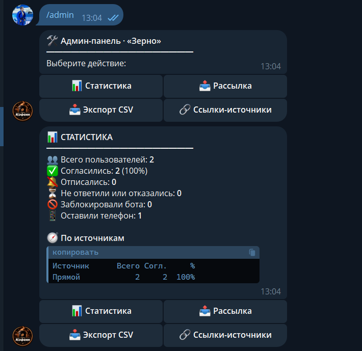

# ☕ Бот «Приветствие и согласие» — Telegram

Приветственный бот, в котором человек **сам подтверждает согласие** на сообщения. Бот запоминает, **откуда пришёл человек**, а владелец через админ-панель смотрит статистику, выгружает контакты и делает рассылку **только согласившимся**.

> Демо-проект по мотивам задачи с фриланс-биржи: у компании нет сохранённых контактов, а массовые рассылки по клиентам вызывают жалобы и блокировку аккаунта. Бот показывает, как собирать подписчиков законно и с учётом источников. Заведение «Зерно» вымышленное, данные демонстрационные.

🔗 Бот: [@FirstCoffe_agent](https://t.me/FirstCoffe_agent)
Живая демонстрация по запросу: бот включается на время показа.

## 🖼 Скриншоты

### Для владельца (админ-панель)



*Доступно только владельцу (`ADMIN_ID`), обычный пользователь эти функции не видит.*

## ✨ Возможности

### Для клиента

- Красивое приветствие с кнопками согласия, под каждый источник перехода своя строка и свой промокод.
- Меню и контакты заведения, промокод после согласия.
- Необязательный номер телефона (кнопка «Поделиться номером», можно пропустить).
- Отписка в любой момент: `/stop`, настройки или кнопка под каждым сообщением рассылки.
- Кнопка «Удалить мои данные» стирает профиль, согласие и телефон.
- Понятный текст о том, какие данные хранятся.

### Для владельца (команда `/admin`)

- 📊 **Статистика:** сколько человек пришло, согласилось, отписалось, заблокировало бота, оставило телефон. Отдельная таблица по источникам с процентом согласившихся.
- 🔗 **Ссылки-источники:** готовые ссылки для сайта, Instagram, рекламы, QR-кода и партнёров.
- 📥 **Экспорт CSV** (открывается в Excel с кириллицей).
- 📤 **Рассылка:** текст или фото с подписью, выбор аудитории (все или один источник), предпросмотр и подтверждение перед отправкой.

## 🧭 Как работает отслеживание источников

В каждой ссылке на бота зашита метка:

```
https://t.me/ваш_бот?start=site        → источник «Сайт»
https://t.me/ваш_бот?start=instagram   → источник «Instagram»
https://t.me/ваш_бот?start=qr          → источник «QR-код»
```

Бот читает метку из команды `/start` и сохраняет её вместе с профилем. Своя метка (латиница, цифры, `_`) появляется в статистике автоматически. Источник фиксируется по первому переходу, после согласия он не меняется.

## 🛡 Согласие и безопасность

- Рассылка идёт **только тем, кто нажал «Да, согласен(на)»**, и не уходит отписавшимся и заблокировавшим бота.
- Каждое согласие и отзыв записываются в журнал с датой.
- Рассылка отправляется с паузами (около 20 сообщений в секунду), бот ждёт при лимитах Telegram и сам отмечает заблокировавших.
- Админ-функции доступны только пользователю с `ADMIN_ID`, остальным бот отвечает как на обычное сообщение. Бот работает только в личных чатах.
- Токен и `ADMIN_ID` хранятся в `.env`, который не попадает в репозиторий.

## 🛠 Стек

- Python 3.10+
- [aiogram 3](https://docs.aiogram.dev/)
- SQLite (таблицы пользователей, журнала согласий и рассылок)
- python-dotenv

## 🚀 Установка и запуск

1. Создайте виртуальное окружение и установите зависимости:

   ```bash
   python -m venv venv
   venv\Scripts\activate        # Windows
   # source venv/bin/activate   # Linux / macOS
   python -m pip install -r requirements.txt
   ```

2. Создайте бота в [@BotFather](https://t.me/BotFather) и получите токен.

3. Создайте файл `.env` в корне проекта:

   ```
   BOT_TOKEN=ваш_токен
   ADMIN_ID=ваш_telegram_id
   ```

   Свой числовой Telegram ID можно узнать, например, у бота @userinfobot.

4. Запустите бота:

   ```bash
   python bot.py
   ```

### Настройки

| Переменная  | Назначение                                   | По умолчанию     |
|-------------|----------------------------------------------|------------------|
| `BOT_TOKEN` | Токен бота от BotFather (обязательно)        | —                |
| `ADMIN_ID`  | Telegram ID владельца, включает админ-панель | не задан (выкл.) |
| `DB_PATH`   | Путь к файлу базы данных                     | `subscribers.db` |

Название заведения, меню, контакты, источники и промокоды меняются в блоке «Настройки демо-заведения» в начале `bot.py`.

## 📁 Структура проекта

```
.
├── bot.py             # весь код бота
├── requirements.txt   # зависимости
├── docs/              # скриншоты для README
├── .env               # токен и ADMIN_ID (не попадает в репозиторий)
└── README.md
```

## ⚠️ Ограничения демо

- Интеграция с CRM и сквозной аналитикой (например, AmoCRM, call-touch) не входит в демо: для неё нужны доступы заказчика. Источники можно выгрузить в CSV или передать в CRM отдельным этапом.
- Бот написан только для Telegram, второй мессенджер из исходной задачи не затронут.

## 🧩 Идеи для развития

- передача данных в CRM или Google Таблицу;
- автоответы и сценарии для новых подписчиков;
- отложенная рассылка по расписанию;
- несколько администраторов.

## 📬 Контакты

Разработка Telegram-ботов под заказ: [@ваш_ник](https://t.me/ваш_ник)
